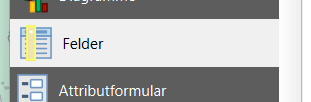
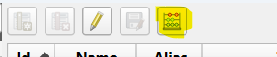
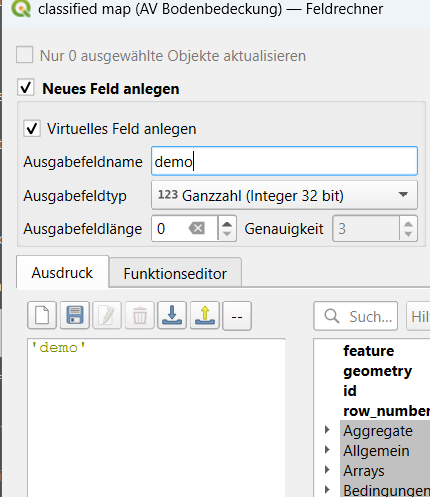
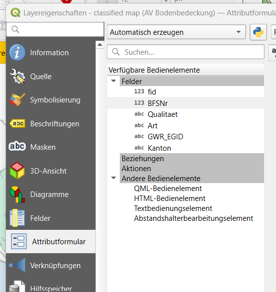
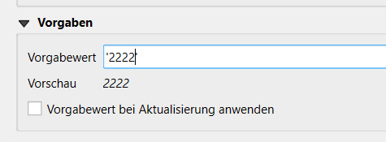
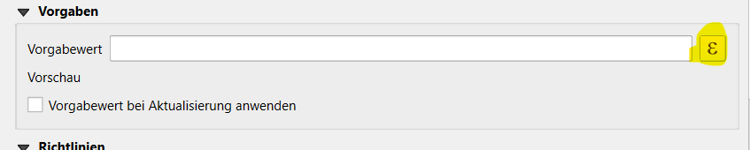
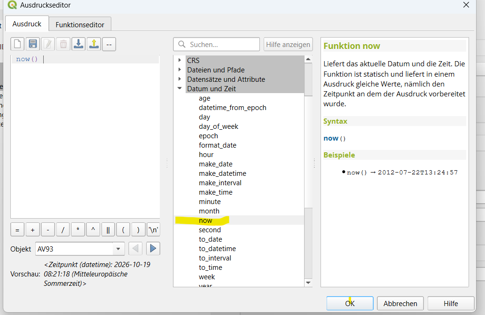
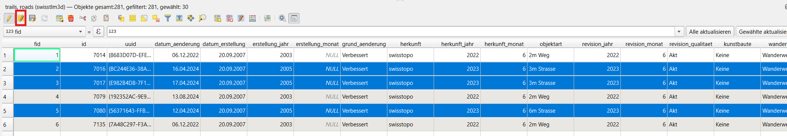
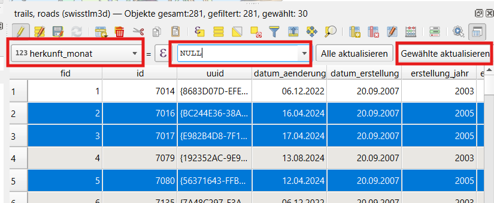

# Fonctions des formulaires et des tables

## Fonctions de formulaire et de table

### 169 - Parallélisme

|  |  |
|----|----|
|  |  |
|  |  |

Propriétés de la couche > Champs > Calculatrice de champs > Créer un champ virtuel.

Créer un champ virtuel avec une expression (fonction), puis le faire glisser dans le formulaire.

Propriétés de la couche > Formulaire d'attributs > Concepteur glisser-déposer > Ajouter le champ créé précédemment.
Ouvrir le formulaire d'une entité.

### 278 - Définir, modifier et supprimer des valeurs par défaut

|  |  |
|----|----|
|  |  |

Propriétés de la couche > Champs > Calculatrice de champs > Créer un champ virtuel.

Ouvrir les propriétés de la couche > Formulaire d'attributs et sélectionner un champ.

Dans « Valeurs par défaut », définir une valeur par défaut.

### 279 - Définir dynamiquement des valeurs par défaut (modèle de données, utilisateur)

|  |  |
|----|----|
|  |  |
|  |  |

Ouvrir les propriétés de la couche > Formulaire d'attributs.
Pour un champ, définir l'expression de valeur par défaut `@user_account_name` (ou `@user_full_name`).
Pour un champ de date, définir l'expression `now()`.

### 280 - Modifier des valeurs de données individuelles

|  |  |
|----|----|
|  |  |

Activer le mode édition et sélectionner plusieurs entités.

Ouvrir la table attributaire et passer en vue formulaire.

Activer « Modifier plusieurs entités simultanément ».

Modifier une valeur d'attribut et appliquer la modification.

Il est également possible d'utiliser la calculatrice de champs pour définir une valeur pour la sélection.

Enregistrer les modifications.

[<u>https://docs.qgis.org/3.44/en/docs/user_manual/working_with_vector/attribute_table.html#multi-edit-fields</u>](https://docs.qgis.org/3.44/en/docs/user_manual/working_with_vector/attribute_table.html#multi-edit-fields)

### 285 - Supprimer plusieurs valeurs de données

|  |  |
|----|----|
|  |  |

Activer le mode édition et sélectionner plusieurs entités.

Ouvrir la vue table.

Sélectionner un attribut.

Définir la valeur des champs texte, booléen et liste déroulante sur NULL.

Exécuter « Tout mettre à jour » ou « Mettre à jour les entités sélectionnées ».

Enregistrer et vérifier les valeurs dans la base de données.

[<u>https://docs.qgis.org/3.44/en/docs/user_manual/working_with_vector/attribute_table.html#multi-edit-fields</u>](https://docs.qgis.org/3.44/en/docs/user_manual/working_with_vector/attribute_table.html#multi-edit-fields)